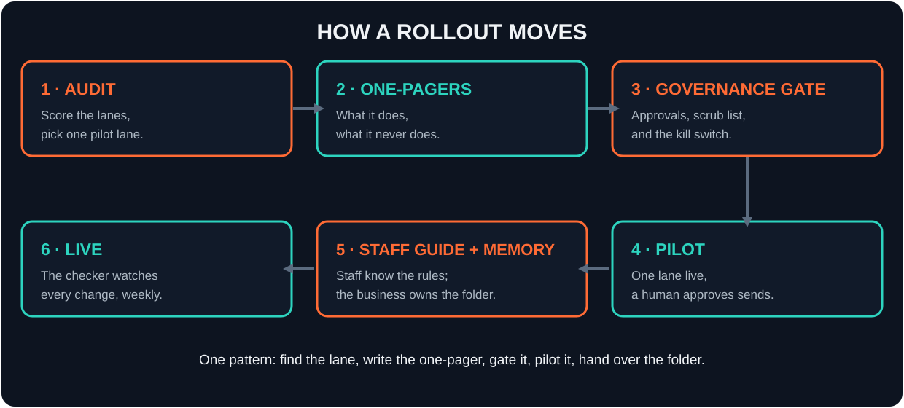
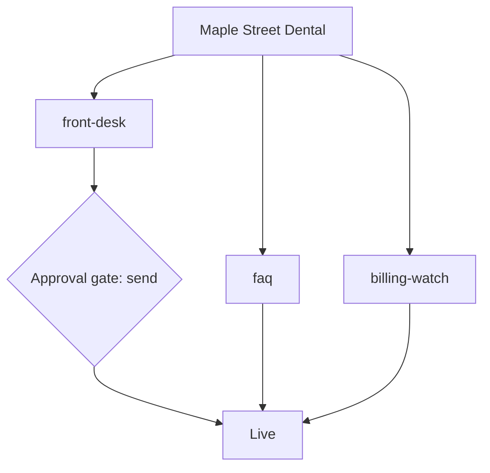

<p align="center">
  
</p>

<p align="center">
  
  
  
  
  
</p>

# AI Rollout Pack

**Put an AI employee to work inside a small business — without handing it the keys.** The pattern is always the same: find one lane worth automating, write its one-pager, gate anything that leaves the business behind a human approval, pilot it with a person in the loop, and hand over a memory folder the business owns. This repo contains that pattern twice: as **documents** a business owner can read, sign, and pin to a wall (the Pack), and as a small **CLI** that scaffolds a rollout folder and lints it against seven governance rules before anything goes live.

## Why this exists

Most AI rollouts in small businesses do not fail because the model was weak. They fail on adoption and governance: nobody wrote down what the AI employee is allowed to do, nobody owns it when it is wrong, corrections evaporate between chats, and the first time it contacts the wrong person, the whole project gets switched off. The fix is boring and it works — a job description on one page, approval gates, a do-not-contact rule enforced by code, a kill switch someone has actually pulled, and memory kept in files the business owns. This pack is that fix, packaged.

## What's inside

### The Pack — documents (in `pack/`)

| Document | What it is |
| --- | --- |
| [Employee one-pager](pack/employee-one-pager.md) | One page per lane: what it owns, its tools, its approval gates, what it never does. Includes a filled example. |
| [Governance sheet](pack/governance-sheet.md) | The five commitments: a named owner per lane, approval gates, the absolute do-not-contact (scrub) rule, a tested kill switch, business-owned memory. Sign-off block included. |
| [Staff guide](pack/staff-guide.md) | For the humans: how to ask, how to correct (fix the source, not just the output), where memory lives, what it will never do. |
| [Rollout checklist](pack/rollout-checklist.md) | Day 1 / Week 1 / First month. Governance before go-live; scope earned from a clean log. |
| [Memory folder](pack/memory-folder.md) | Why the folder is the asset, how it is structured, and the three rules that keep it true. |

### The CLI — `rollout-pack`

Zero dependencies, Python standard library only.

| Command | What it does |
| --- | --- |
| `rollout-pack init <business-name>` | Scaffolds `./<slug>-rollout/` with `rollout.json`, governance and staff-guide documents, a checklist, a memory folder, and a starter one-pager. |
| `rollout-pack check <folder>` | Lints a rollout against governance rules R1–R7. Exit 1 if any rule fails. |
| `rollout-pack map <folder>` | Prints a Mermaid workflow map of the rollout (and writes `workflow-map.md` beside it). |
| `rollout-pack demo` | Runs init → check → map on a fictional business in a temp folder, end to end. |

### The worked example (in `examples/`)

[Maple Street Dental](examples/maple-street-dental/) — a **fictional** dental clinic with a complete rollout: three lanes (a gated front-desk, a read-only FAQ lane, a flag-only billing watcher), filled governance, memory, one-pagers, and its generated workflow map. `rollout-pack check examples/maple-street-dental` passes all seven rules.

### The case study (in `case-study/`)

[The pattern running in production](case-study/edge-stack.md) — a sanitized account of the author's real systems: a governed lead pipeline with lanes, dedup, a hard do-not-contact list enforced in code, a 50/day send cap and human approval before sends; and an AI-employee framework built on clock-in context, written skills, and an approval gate. No client or personal details; the structure is the point.

## Quickstart

```bash
pip install -e .
rollout-pack demo
```

The demo scaffolds a rollout for a fictional business, lints it, and maps it:

```text
--- rollout-pack check ---
R1 PASS - rollout.json names 'Demo Dental Co'
R2 PASS - 1 lane(s), each with an owner
R3 PASS - every lane is read-only or approval-gated
R4 PASS - every send/publish/pay tool is gated
R5 PASS - memory/MEMORY.md exists and is written
R6 PASS - governance names the kill switch and scrub rule
R7 PASS - every lane has a one-pager
```

Start your own:

```bash
rollout-pack init "Acme Dental"        # creates ./acme-dental-rollout/
rollout-pack check acme-dental-rollout # lint it before go-live
rollout-pack map acme-dental-rollout   # see the lanes and their gates
```

Checking the bundled example:

```text
$ rollout-pack check examples/maple-street-dental
R1 PASS - rollout.json names 'Maple Street Dental'
R2 PASS - 3 lane(s), each with an owner
R3 PASS - every lane is read-only or approval-gated
R4 PASS - every send/publish/pay tool is gated
R5 PASS - memory/MEMORY.md exists and is written
R6 PASS - governance names the kill switch and scrub rule
R7 PASS - every lane has a one-pager

All 7 governance rules pass for examples/maple-street-dental.
```

## The seven governance rules

The checker enforces what the governance sheet promises:

| Rule | Requirement |
| --- | --- |
| R1 | `rollout.json` exists, parses, and names the business. |
| R2 | At least one lane; every lane has a name, an "owns", and a named human owner. |
| R3 | Every lane is either read-only or has a non-empty approval list. Nothing acts ungated. |
| R4 | Any lane that can `send`, `publish`, or `pay` must gate that exact action. |
| R5 | `memory/MEMORY.md` exists and is written — if it is not written down, the AI employee does not know it. |
| R6 | `governance.md` names the kill switch and the do-not-contact / scrub rule. |
| R7 | Every lane has its one-pager at `one-pagers/<lane>.md`. |

## Workflow map

How a rollout moves, from audit to live:

<p align="center">
  
</p>

And the map the CLI generates for the example clinic (diamonds are approval gates):



## Repo structure

```
ai-rollout-pack/
  rollout_pack/          the CLI package (stdlib only)
    cli.py               init / check / map / demo
    scaffold.py          rollout folder scaffolder
    checker.py           the seven governance rules
    mapping.py           Mermaid map renderer
    templates/           the documents init copies into a new rollout
  pack/                  the human-facing documents
  case-study/            the pattern running in production (sanitized)
  examples/
    maple-street-dental/ a complete fictional rollout (passes all rules)
  assets/                icon, banner, workflow map (static SVG)
  tests/                 pytest suite (21 tests)
```

## Roadmap

- v0.2: a `rollout-pack audit` helper that scores candidate lanes from a filled-in worksheet.
- v0.2: more example rollouts (trades, retail) beyond the dental clinic.
- Later: export the impact log format used in the checklist's month review, so hours-saved reporting is as checkable as the rollout itself.

## Honesty

- This is templates plus a linter, not magic. The pack structures the human work — writing the one-pager, naming the owner, signing the governance sheet. It does not automate judgment, and a folder that passes every rule can still describe a bad rollout if the humans wrote careless one-pagers.
- The checker verifies that governance is *written down and internally consistent*. It cannot verify that a business actually follows it. That part is management, and no tool in this repo pretends otherwise.
- Maple Street Dental is fictional, and is labelled that way everywhere it appears. The case study describes the author's real systems with private details removed; the only number it claims is the 50/day governed cap.
- The packaging is finished; the method's proof is the case study and the checker's test suite, not this README.

## License

MIT — see [LICENSE](LICENSE). Use the pack inside your business or your client work; the folder it creates belongs to whoever it describes.
